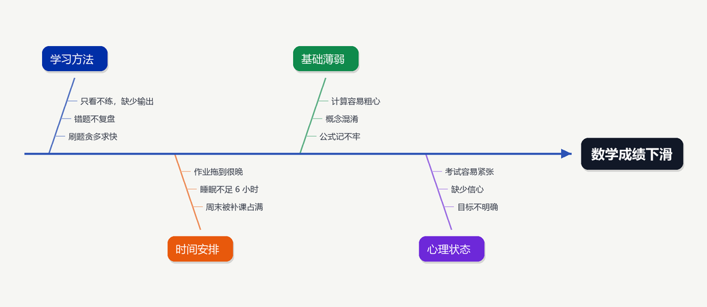
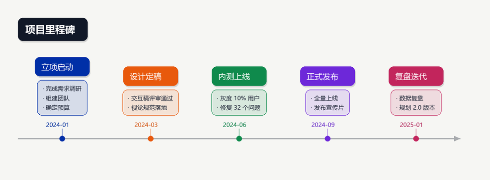
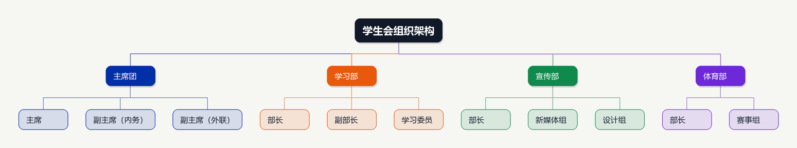
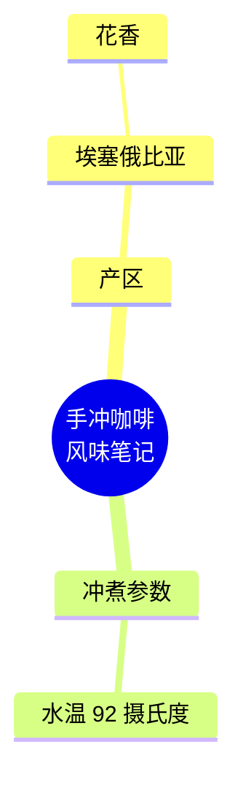
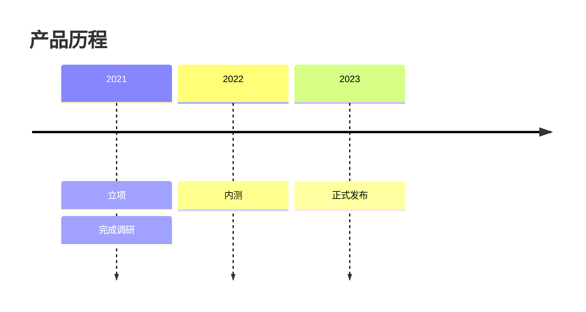

# Markdown 图形工坊（MdMindMap）

把 Markdown 大纲一键转成**思维导图、鱼骨图、时间轴、组织结构图**：左侧编辑原文，右侧实时出图，可导出 PNG、SVG 和可交互的 HTML。
Windows 用户可以直接使用打包好的单文件 `MdMindMap.exe`，不需要安装 Python。


## 四种图形

| 图形 | 适合的内容 | 结构映射 |
| --- | --- | --- |
| 思维导图 | 学习笔记、方案拆解、知识梳理 | 根节点居中，一级分支向两侧展开 |
| 鱼骨图 | 原因分析、问题复盘、风险归因 | 根节点是结果（鱼头），一级是主因，更深层是子因 |
| 时间轴 | 项目里程碑、发展历程、版本节奏 | 一级是时间点，写成 `2024-03 事件名` 会自动拆出日期徽章 |
| 组织结构图 | 团队架构、目录层级、任务分解 | 根节点在顶部，逐层向下展开 |

**鱼骨图**



**时间轴**



**组织结构图**



## 功能

- **四种图形自由切换**：顶部下拉框选「自动识别」或手动指定，快捷键 `Ctrl+1` ~ `Ctrl+5`；自动模式会识别 `mermaid timeline` 代码块，也会把「一级要点大多是日期」的大纲判为时间轴。
- **两种解析方式**：普通 Markdown 结构（`#` 标题、`-` 列表、缩进、引用、段落、表格、任务清单），或文档中的 ```mermaid mindmap / timeline 代码块（优先使用）。
- **实时预览**：编辑区改动后自动重绘，节点按层级分支配色，父节点垂直居中于子树。
- **交互操作**：点击节点折叠 / 展开，滚轮缩放，拖拽平移，`F` 键适应窗口，一键展开全部或折叠到二级。
- **三种导出**：PNG（2 倍超采样，可选透明背景）、SVG（矢量）、HTML（单文件网页，自带缩放、平移与「下载 SVG」）。
- **两种主题**：浅色（默认）与深色。
- **内置示例模板**：菜单「图形 → 载入示例模板」一键切换四种示例，工具栏「示例」按钮循环切换。
- **命令行模式**：不打开界面也能批量转换，`--diagram` 指定图形类型。

## 直接使用 exe（推荐给 Windows 用户）

1. 从 [Releases](https://github.com/kun433/md-mindmap/releases) 下载 `MdMindMap.exe`；
2. 双击打开，把 Markdown 粘到左侧，用顶部下拉框选择图形；
3. 需要图片时点「导出」，选择目录后同时得到 PNG、SVG、HTML。

也可以把 `.md` 文件拖到 `MdMindMap.exe` 上，或命令行调用：

```bat
MdMindMap.exe 笔记.md --diagram fishbone --formats png,svg,html -o 输出目录
```

`--diagram` 支持 `auto`、`mindmap`、`fishbone`、`timeline`、`org`，也接受「鱼骨图」「时间轴」这样的中文名。

首次运行 Windows 可能提示「Windows 已保护你的电脑」，这是因为 exe 没有商业代码签名证书，
点击「更多信息 → 仍要运行」即可；介意的话可以用下面的方式自行构建。

## 从源码运行与构建

```bat
python -m pip install -r requirements.txt

python main.py                                          :: 打开图形界面
python main.py 笔记.md --diagram timeline --formats png -o out
python main.py 笔记.md --theme dark --scale 3            :: 深色主题、3 倍超采样

python tests/test_core.py                               :: 解析、四种图形布局与导出的单元测试
python tests/smoke_gui.py                               :: 图形界面冒烟测试（逐个切换四种图形）
python build.py                                         :: 生成 exe 到 dist\MdMindMap.exe
```

Windows 上也可以直接双击 `build.bat`，脚本会自动装依赖、跑测试并打包。

## Markdown 写法

标题层级和列表缩进都会被转换成节点，两种写法可以混用：

```markdown
# 数学成绩下滑

## 学习方法
- 只看不练
- 错题不复盘
  - 错题只抄答案
- 刷题贪多求快

## 时间安排
- 作业拖到很晚
- 睡眠不足
```

同一份内容换一种图形就是另一种表达：切到「鱼骨图」，「数学成绩下滑」成为鱼头，「学习方法 / 时间安排」成为主因，列表项成为子因；切到「组织结构图」则变成自上而下的层级树。

时间轴的写法只要给一级要点加上日期前缀，日期会自动变成轴上的徽章：

```markdown
# 项目里程碑

## 2024-01 立项启动
- 完成需求调研
- 组建团队

## 2024-06 内测上线
- 灰度 10% 用户
- 修复 32 个问题

## 2024-09 正式发布
- 全量上线
```

支持 `2024-03`、`2024年6月`、`2024/3/15`、`Q3`、`第三阶段`、`12月` 等前缀。

如果文档里已经有 mermaid 代码块，程序会直接读取它。思维导图：

````markdown

````

时间轴：

````markdown

````

关闭工具栏上的「优先 mermaid」开关，就会改为按文档的标题和列表结构解析。
`samples/` 目录下有四种图形可直接试用的示例文件。

## 项目结构

```text
md-mindmap/
├── main.py                  程序入口（界面 / 命令行）
├── md_mindmap/
│   ├── parser.py            Markdown、mermaid mindmap / timeline 解析，图形类型识别
│   ├── layout.py            通用场景模型（节点 + 连线）、文本测量、思维导图布局
│   ├── diagrams.py          鱼骨图 / 时间轴 / 组织结构图布局与统一入口
│   ├── theme.py             浅色 / 深色配色、节点与连线画笔
│   ├── exporter.py          PNG / SVG / HTML 渲染
│   ├── fonts.py             中文字体解析（微软雅黑 → 黑体 → 宋体 → 内置字体）
│   ├── templates.py         内置示例模板
│   └── app.py               Tkinter 图形界面
├── samples/                 四种图形的示例 Markdown
├── tests/                   单元测试与界面冒烟测试
├── tools/                   图标生成、版本信息、发布脚本
├── build.py / build.bat     一键打包脚本
└── docs/                    效果预览图
```

## 实现要点

- **统一场景模型**：所有图形先被排成「节点框 + 折线」的场景（`Layout.nodes` / `Layout.edges`），PNG、SVG、Tk、HTML 四套渲染共用一套绘制逻辑；新增图形只需要写布局。
- **解析**：先收集行级结构块（标题深度、列表缩进级、引用、段落、表格），再用栈压平成一棵树；列表缩进单位自动推断，兼容 2 空格与 4 空格缩进。
- **思维导图**：两趟计算，先测量每列最大宽度，再自底向上求子树高度，父节点放在子树垂直中心，列间用贝塞尔曲线连接。
- **组织架构图**：自底向上累加子树宽度，自上而下居中摆放，父子之间用肘形折线连接。
- **鱼骨图**：主骨横向通向鱼头，主因骨刺上下交替并向右倾斜，子因沿骨刺依次排开，标签固定在骨刺末端。
- **时间轴**：日期前缀拆成徽章贴近主轴，事件卡片与细目依次向上堆叠，主轴带箭头与节点圆点。
- **渲染**：PNG 用 Pillow 在 2 倍画布上绘制后缩放，避免锯齿；SVG 与 HTML 复用同一套坐标，保证三种导出视觉一致。

## 已知限制

- 时间轴目前是单行横向排列，事件特别多时画布会很长；
- 单节点不做手动折行控制，超长文本按固定宽度自动换行；
- 打包体积约 20 MB 以上，主要来自 Python 运行时与 Tkinter。

## 许可

[MIT](LICENSE)
