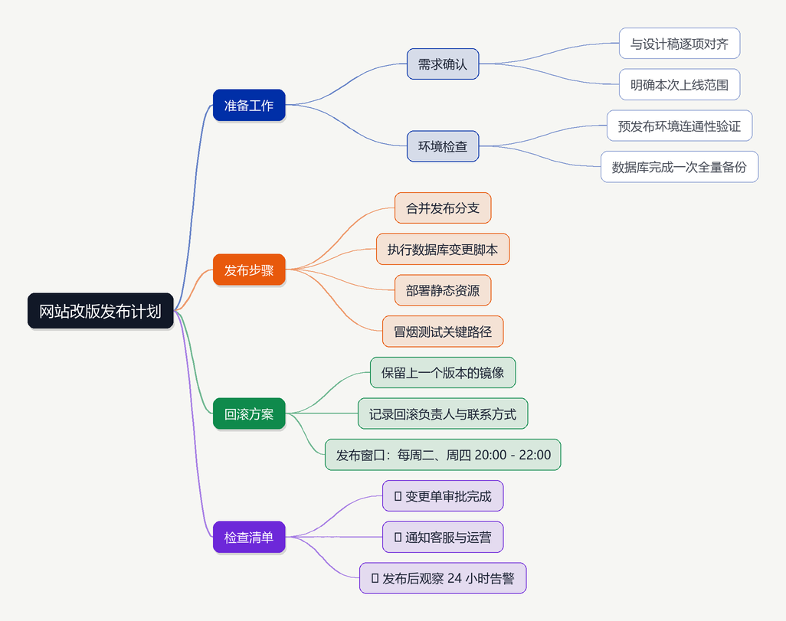
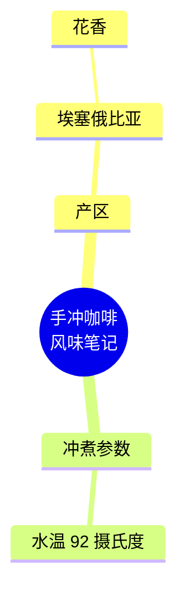

# Markdown 思维导图（MdMindMap）

把 Markdown 大纲一键转成思维导图：左侧编辑原文，右侧实时出图，可导出 PNG、SVG 和可交互的 HTML。
Windows 用户可以直接使用打包好的单文件 `MdMindMap.exe`，不需要安装 Python。



## 功能

- **两种解析方式**：普通 Markdown 结构（`#` 标题、`-` 列表、缩进、引用、段落、表格、任务清单），或文档中的 ```mermaid mindmap 代码块（优先使用）。
- **实时预览**：编辑区改动后自动重绘，节点按层级分支配色，父节点垂直居中于子树。
- **交互操作**：点击节点折叠 / 展开，滚轮缩放，拖拽平移，`F` 键适应窗口，一键展开全部或折叠到二级。
- **三种导出**：
  - PNG：2 倍超采样渲染，适合贴到文档、聊天窗口或打印；
  - SVG：矢量图，可继续在 Illustrator / Inkscape 里修改；
  - HTML：单文件网页，自带缩放、平移和「下载 SVG」按钮，可直接分享。
- **两种主题**：浅色（默认）与深色，命令行与界面都可以切换。
- **命令行模式**：不打开界面也能批量转换，适合脚本或批处理。

## 直接使用 exe（推荐给 Windows 用户）

1. 从 [Releases](https://github.com/kun433/md-mindmap/releases) 下载 `MdMindMap.exe`；
2. 双击打开，把 Markdown 粘到左侧，或用「打开 Markdown」选择文件；
3. 需要图片时点「导出」，选择目录后同时得到 PNG、SVG、HTML。

也可以把 `.md` 文件拖到 `MdMindMap.exe` 上，或命令行调用：

```bat
MdMindMap.exe 笔记.md --formats png,svg,html -o 输出目录
```

首次运行 Windows 可能提示「Windows 已保护你的电脑」，这是因为 exe 没有商业代码签名证书，
点击「更多信息 → 仍要运行」即可；介意的话可以用下面的方式自行构建。

## 从源码运行与构建

```bat
python -m pip install -r requirements.txt

python main.py                                  :: 打开图形界面
python main.py 笔记.md --formats png -o out      :: 命令行转换
python main.py 笔记.md --theme dark --scale 3    :: 深色主题、3 倍超采样

python tests/test_core.py                        :: 解析与导出的单元测试
python tests/smoke_gui.py                        :: 图形界面冒烟测试
python build.py                                  :: 生成 exe 到 dist\MdMindMap.exe
```

Windows 上也可以直接双击 `build.bat`，脚本会自动装依赖、跑测试并打包。

## Markdown 写法

标题层级和列表缩进都会被转换成节点，两种写法可以混用：

```markdown
# 网站改版发布计划

## 准备工作
- 需求确认
  - 与设计稿逐项对齐
  - 明确本次上线范围
- 环境检查

> 发布窗口：每周二、周四 20:00 - 22:00
```

如果文档里已经有 mermaid 思维导图，程序会直接读取它，不用重排结构：

````markdown

````

关闭工具栏上的「优先 mermaid」开关，就会改为按文档的标题和列表结构解析。

`samples/` 目录下有两个可直接试用的示例文件。

## 项目结构

```text
md-mindmap/
├── main.py                  程序入口（界面 / 命令行）
├── md_mindmap/
│   ├── parser.py            Markdown 与 mermaid mindmap 解析
│   ├── layout.py            树布局计算（列宽、子树高度、贝塞尔连线）
│   ├── theme.py             浅色 / 深色配色
│   ├── exporter.py          PNG / SVG / HTML 渲染
│   ├── fonts.py             中文字体解析（微软雅黑 → 黑体 → 宋体 → 内置字体）
│   └── app.py               Tkinter 图形界面
├── samples/                 示例 Markdown
├── tests/                   单元测试与界面冒烟测试
├── tools/                   图标生成、版本信息、发布脚本
├── build.py / build.bat     一键打包脚本
└── docs/preview.png         效果预览
```

## 实现要点

- **解析**：先收集行级结构块（标题深度、列表缩进级、引用、段落、表格），再用栈压平成一棵树；列表缩进单位自动推断，兼容 2 空格与 4 空格缩进。
- **布局**：两趟计算。第一趟测量每个节点的换行文本尺寸并得到每列最大宽度，第二趟自底向上求子树高度，再自上而下把父节点放在子树垂直中心，列间用贝塞尔曲线连接。
- **渲染**：PNG 用 Pillow 在 2 倍画布上绘制后缩放，避免锯齿；SVG 与 HTML 复用同一套坐标，保证三种导出视觉一致。中文字体按「微软雅黑 → 黑体 → 宋体 → Pillow 内置字体」顺序回退。

## 已知限制

- 只支持右向树布局，没有鱼骨图、时间轴等其它图形；
- 极长文本会自动换行，但单节点不做手动折行控制；
- 打包体积约 20 MB 以上，主要来自 Python 运行时与 Tkinter。

## 许可

[MIT](LICENSE)
